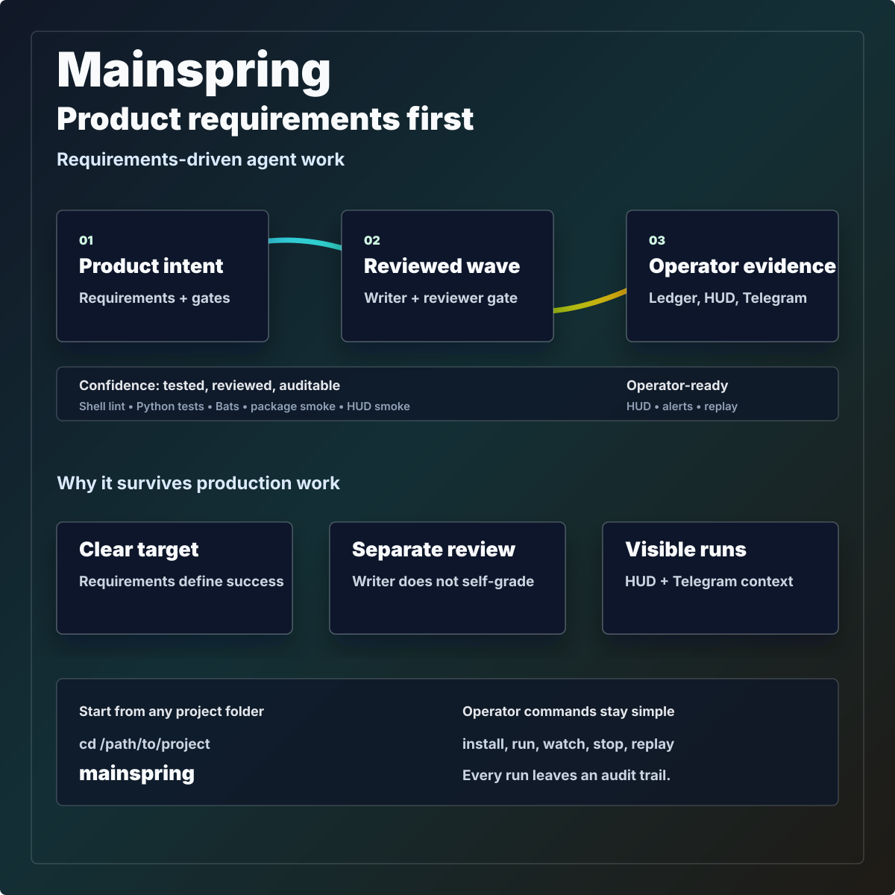
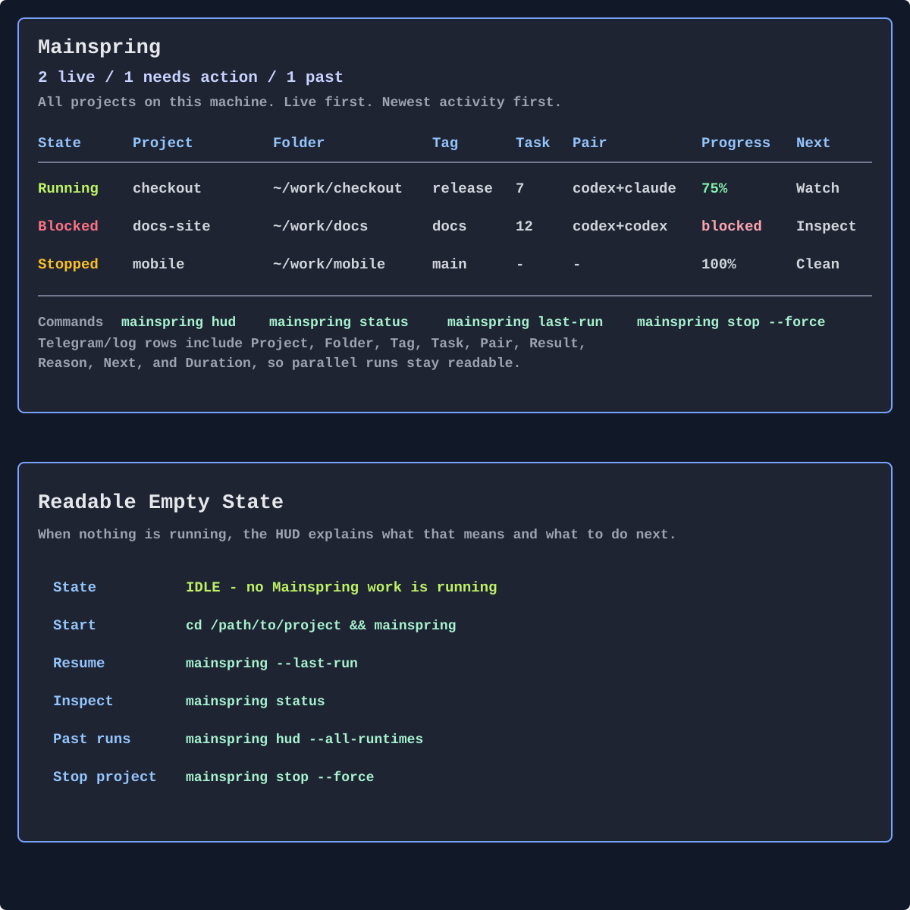

# Mainspring

Product Requirements Document (PRD)-first AI coding agent orchestration for production-grade software delivery.
Reviewed, auditable autonomous coding instead of chat sprawl.

Mainspring makes autonomous agents behave like a small engineering team: it starts from a Product Requirements Document (PRD),
runs bounded writer/reviewer waves, records JSONL evidence, shows terminal HUD progress, and sends Telegram alerts when something matters.
<p>
  
  
  
  
  
</p>



v1 source install is the entrypoint: clone once, install the global command, then run `mainspring` from any project.
Everything starts from the same operator CLI people use day to day.

## Install Mainspring

```bash
python3 -m pip install --user pipx
python3 -m pipx ensurepath  # Homebrew: brew install pipx && pipx ensurepath
git clone https://github.com/dlogvinenko/mainspring.git
cd mainspring
make install-user
```

Check the install with `command -v mainspring`, `mainspring --version`, and `mainspring --help`.

If `command -v mainspring` prints nothing, make sure the pipx app directory
`~/.local/bin` is on your shell PATH, then reopen the terminal.
`mainspring --help` is the short operator help; `mainspring help --full` prints the full CLI contract.

After local Mainspring source changes, rerun `make install-user` from this
checkout to refresh the global command. The target recreates the pipx app
environment before installing, so stale optional provider dependencies do not
survive an update. Provider installs require patched filelock and may select an
earlier allowed LiteLLM: `MAINSPRING_PROVIDERS_PYTHON=python3.13 make install-user-providers` (Python 3.11-3.13).

Source checkouts can also run `./mainspring.sh --project /path/to/your-project`.
The packaged `mainspring` command uses its own pipx Python, so a project's
`.venv` cannot downgrade the HUD or hide Rich UI support. The v1 install path
is source install until package-manager channels are actually published.

## Why It Exists

Vibe coding is fast until the work has to survive real users, tests, releases,
and maintenance. Mainspring exists for the moment when "just ask the model" is
no longer enough.

| Signal | Without Mainspring | With Mainspring |
| --- | --- | --- |
|  | The agent starts coding before the target is clear. |  A Product Requirements Document (PRD) captures what success means before execution. |
|  | One model writes and informally declares victory. |  A separate reviewer must pass structured score and delta fields. |
|  | Long sessions lose track of what changed and why. |  Every wave records files, verdict, duration, cost, and failure reason. |
|  | Parallel runs all look the same in logs and notifications. |  Telegram messages include project, folder, Taskmaster tag, task, pair, result, duration, reason, and next action. |
|  | You cannot see if the loop is stuck without reading scrollback. |  `mainspring hud` gives a live global dashboard. |

## Start Here

If Mainspring is already installed, the first command is just:

```bash
cd /path/to/your-project
mainspring
```

That opens the guided start flow in an interactive terminal. It can initialize
local `.mainspring/` state, point at your Product Requirements Document (PRD)
or Taskmaster backlog, and help choose a safe first run.

If `mainspring` has no interactive terminal or piped wizard answers, it does
not guess. It prints explicit next steps: pipe wizard answers, reopen a terminal, run
`mainspring last-run`, `mainspring --last-run`, or
`mainspring --preset fast-smoke --dry-run`, or scaffold Product Requirements
Document (PRD) starter docs with `mainspring init checkout-redesign` after
replacing `checkout-redesign` with your feature name.

`mainspring doctor` is only the diagnostic command for checking dependencies
and environment problems. It is useful when something is broken; it is not the
normal first-run path.

## What Happens

| Step | What Mainspring does | Why it matters |
| --- | --- | --- |
| 1. Initialize | Creates `.mainspring/` local run state and helps you point at a Product Requirements Document (PRD) or Taskmaster backlog. | The project gets local, inspectable state instead of hidden hosted state. |
| 2. Plan | Uses a Product Requirements Document (PRD) or Taskmaster tasks to select bounded work. | The agent works against intent, not vibes. |
| 3. Execute | Runs a writer agent with Claude, Codex, or a LiteLLM provider. | You can choose the engine pair that fits the work. |
| 4. Review | Runs a separate reviewer gate before claiming progress. | The writer does not grade its own work. |
| 5. Record | Records wave evidence, changed files, tests, scores, and failures. | You can audit, replay, and debug the run later. |

## Key Features

| Feature | Command | Why you care |
| --- | --- | --- |
| Guided first run | `mainspring` | Start from the project directory; if saved settings exist, it shows them first and offers to continue. |
| Remembered setup | `mainspring last-run --format json` | See exactly how this project was last launched and copy the repeat/preview commands. |
| Live dashboard | `mainspring hud` | See every live Mainspring work process on the machine: folder, PID, tag, task, wave, pass/fail state, notifier health, and team state. |
| Telegram alerts | `mainspring notify-test` | After the test passes, set `MAINSPRING_NOTIFY_ENABLED=1` before a run to get project/folder/tag-aware messages for failures, retry loops, loop stops, quota, stuck teams, milestones, and daily digest. |
| Safe smoke run | `mainspring --preset fast-smoke --dry-run` | Preview commands with zero API calls and no file mutation. |
| One reviewed wave | `mainspring taskmaster --once` | Take one ready Taskmaster item through writer/reviewer verification. Malformed dependency collections do not establish readiness; missing/null fields and empty arrays keep their no-prerequisite behavior. |
| PRD-driven work | `mainspring night --prd docs/prd.md --once` | Let the Product Requirements Document (PRD) select the next useful slice. |
| Metrics | `mainspring --metrics --days 7 --routing` | Read pass rate, duration, routing, cost, and stuck-task signals for the last week. |
| Replay | `mainspring replay show last .mainspring/logs/waves.jsonl` | Inspect past waves without trusting memory or terminal scrollback. Replay children use controls from the current source and invocation, including `--save-as`; inherited replay leftovers are ignored without changing the caller or unrelated runtime settings. |

Metrics ignore malformed JSON and non-object JSONL rows. Included objects remain in totals when `exit_code` is missing or invalid; success requires `PASS` and an actual
integer `0` (not Boolean, string, null or float). Time filters require usable zoned timestamps; the ledger writer emits UTC/Z and readers accept explicit offsets. Without
a time filter, timestamp shape does not exclude rows. A date-only `--since YYYY-MM-DD` still starts the window at midnight UTC.

## HUD

The HUD is global and terminal-native. Plain `mainspring hud` opens the live dashboard immediately. It shows every live Mainspring work process on the machine with
project folder, PID, Taskmaster tag, task, lightweight project progress, wave, started/stopped times, newest activity first, Telegram health, quota, and team state:

```bash
mainspring hud
```



HUD state is operator health, not just process existence: `Running` means a run is currently working, `Waiting` means the loop is alive after a clean wave and waiting for
the next result, `Blocked` means repeated failures need human action, `Failed` means the latest wave failed but has not reached the blocked threshold, and `Stopped
cleanly` means the loop found no work or ended without an active failure. `Not running` means a past recorded run has no live process.

The `Progress` value is intentionally lightweight and read-only: Taskmaster leaf tasks
first, then Product Requirements Document (PRD) checkboxes if Taskmaster is not
available. Treat it as an operator signal, not a release gate.

HUD commands:

| Need | Command | Result |
| --- | --- | --- |
| Live dashboard | `mainspring hud` | Watches live Mainspring runs across the machine. |
| One-frame snapshot | `mainspring hud --once` | Prints one terminal frame and exits. |
| Machine-readable snapshot | `mainspring hud --json --once` | Emits `run_count`, `live_count`, `needs_action_count`, `stale_count`, and `runs[]` for scripts and agents. |
| Include old runs | `mainspring hud --all-runtimes` | Adds stale recorded runtimes to the live view. |
| Current project only | `mainspring hud --local` | Hides other projects. |
| Stop current project | `mainspring stop --force` | Stops this project's active run and its owned engine processes before releasing the lock; no following wave starts. |

Use `mainspring stop --help` before forceful recovery outside the current
project.

Replay the committed demo at [`docs/assets/hud-demo.cast`](docs/assets/hud-demo.cast).

## Telegram Notifications

Mainspring can send operator notifications while autonomous work runs:

```bash
export MAINSPRING_TELEGRAM_BOT_TOKEN="..."
export MAINSPRING_TELEGRAM_CHAT_ID="..."
export MAINSPRING_NOTIFY_ENABLED=1
mainspring notify-test
mainspring
```

Actionable event messages include `Project:`, `Folder:`, `Tag:`, `Task:`,
`Pair:`, `Result:`, `Reason:`, `Next:`, and `Duration:` so several projects
can run in parallel without becoming indistinguishable in one chat. Event
classes: `wave_failed`, `retry_loop`, `loop_stopped`, `quota_warn`,
`team_stuck`, `milestone`, and `daily_digest`.

Full setup and recovery commands are in [`docs/guide.md`](docs/guide.md).

## When To Use It

| Decision | Green path | Red flag |
| --- | --- | --- |
| Production work |  Behavior, tests, release docs, or multiple files are involved. |  You only need a tiny throwaway snippet. |
| Autonomy |  You want unattended progress with evidence and rollback clarity. |  You are exploring an idea with no correctness expectation. |
| Planning |  You have a Product Requirements Document (PRD), Taskmaster backlog, or release checklist. |  You do not yet know what problem you are solving. |
| Audit |  You need a durable audit trail for what the agent did. |  Terminal scrollback is enough. |

## Core Concepts

| Concept | Plain-English meaning |
| --- | --- |
| Product Requirements Document (PRD) | A short product contract: what problem we are solving, what success means, what is out of scope, and how to verify it. |
| Mainspring Method | The templates and discipline around product requirements, decisions, audit, reality reset, and task breakdown. |
| Wave | One bounded writer/reviewer attempt with logs, changed files, tests, verdict, and next action. |
| Writer/reviewer pair | One engine writes the change; another independently checks the result. Example: `claude+codex` or `codex+codex`. |
| Fail closed | If credentials, reviewer output, JSON, tests, or scope are wrong, Mainspring stops instead of pretending the work passed. |

## Engine Support

Registered engine keys: `claude`, `codex`, `anthropic`, `openai`, `azure`,
`gemini`, `grok`, `mistral`, `ollama`, `openrouter`, `litellm`.

| Engine | Route | Runtime requirement |
| --- | --- | --- |
| Claude | CLI adapter | `claude` on PATH. |
| Codex | CLI adapter | `codex` on PATH. |
| Anthropic, OpenAI, Azure OpenAI, Google Gemini, xAI Grok, Mistral, OpenRouter | LiteLLM provider | `litellm` plus provider credentials. |
| Ollama | LiteLLM provider | Local Ollama service. |
| LiteLLM | Generic bridge | Provider-specific model string and credentials. |

Engine paths fail closed and never silently fall back to another provider, model or reviewer. Structured Claude quota failures require engine error or rejection evidence.
Task prose about quotas does not itself mean usage is exhausted.

Use `mainspring engines` to inspect setup gaps before a run. Use `mainspring limits` before long unattended work:
`ready` means runnable plus quota/readiness signal; `adapter-only` means credentials or quota are not proven by that offline snapshot.

### Local Model Writer

Use a local writer for private, low-cost iteration, then keep Codex or Claude as
the stronger independent reviewer.

Preview an Ollama writer:

```bash
mainspring engines
mainspring night --prd docs/prd.md --topology solo \
  --engine ollama --model 'ollama/qwen3:8b' \
  --review-engine codex --review-model gpt-5.5 \
  --dry-run --once
```

Preview an MTPLX writer:

```bash
mtplx quickstart \
  --model Youssofal/Qwen3.6-27B-MTPLX-Optimized-Speed \
  --model-id qwen3.6-mtplx \
  --port 18080
OPENAI_API_BASE=http://127.0.0.1:18080/v1 OPENAI_API_KEY=local \
  mainspring night --prd docs/prd.md --topology solo \
  --engine litellm --model 'openai/qwen3.6-mtplx' \
  --review-engine codex --review-model gpt-5.5 \
  --dry-run --once
```

`OPENAI_API_KEY=local` is a harmless localhost placeholder for LiteLLM. Remove
`--dry-run` only after the preview says `Status: READY`. Full setup:
[`docs/guide.md#local-model-writer`](docs/guide.md#local-model-writer).

## Copy/Paste Commands

Each row is a complete command you can paste; flags are shown only as part of real runnable commands, never separate columns.
Full surface: `mainspring help --full` and [`docs/guide.md`](docs/guide.md).

| Need | Run | Result |
| --- | --- | --- |
| Start or continue | `mainspring` | Guided flow; shows saved setup first. |
| Watch every run | `mainspring hud` | Live dashboard across discovered Mainspring runs. |
| Inspect status | `mainspring status` | Read-only project state. |
| Diagnose setup | `mainspring doctor` | Missing deps, engines, locks, notifier, quota, and adapter issues. |
| Preview safely | `mainspring --preset fast-smoke --dry-run` | Resolves commands with zero API calls. |
| Run Taskmaster work | `mainspring taskmaster --once` | One writer/reviewer wave from Taskmaster. |
| Run PRD work | `mainspring night --prd docs/prd.md --once` | One wave from the Product Requirements Document. |
| Stop this project | `mainspring stop --force` | Stops recorded processes for the current project. |
| Test Telegram | `mainspring notify-test` | Sends one configured test alert. |
| Check Telegram | `mainspring notify-health --format json` | Reads notifier health without calling Telegram. |
| Metrics | `mainspring --metrics --days 7 --routing` | Pass rate, duration, routing, cost, stuck tasks. |

## Docs

| Document | Use it for |
| --- | --- |
| [`docs/guide.md`](docs/guide.md) | Operator commands, HUD, Telegram, recovery, modes. |
| [`docs/method.md`](docs/method.md) | The Product Requirements Document (PRD)-first Method and why it beats unstructured vibe coding for production work. |
| [`docs/competitive-analysis.md`](docs/competitive-analysis.md) | Market map, 1000-point release score, fit matrix, and positioning strategy. |
| [`docs/metrics.md`](docs/metrics.md) | Wave ledger JSONL fields and metrics semantics. |
| [`docs/architecture.md`](docs/architecture.md) | Runtime boundaries, modules, and extension points. |
| [`CONTRIBUTING.md`](CONTRIBUTING.md) | How to add engines and contribute safely. |
| [`SECURITY.md`](SECURITY.md) | How to report vulnerabilities without leaking secrets. |
